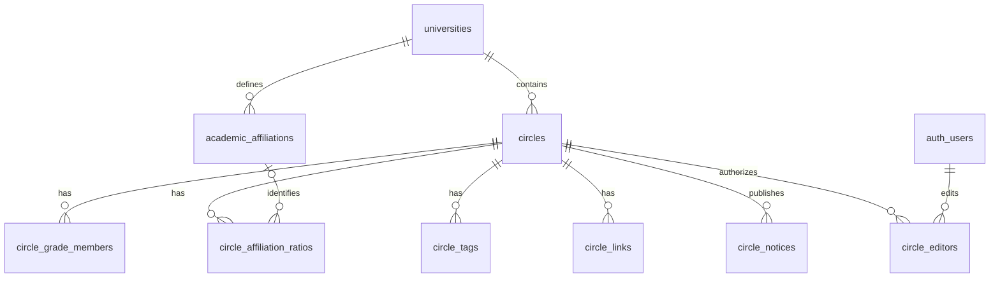

# サークル情報のデータ構造

2026年11月20日決定。既存のSupabaseに将来接続する際の保存契約を定める。今回の成果物は設計書と `src/types/circle.ts` の型定義であり、マイグレーションの作成・適用、データ移行、画面の保存先変更は行わない。

## 基本方針

サークル本体と、複数登録できる分布・タグ・リンク・お知らせを分ける。所属人数は整数で保存し、「約」「名」は表示時に付ける。学類・院コースの選択肢は大学別マスタで管理し、表示名と独立したUUIDを参照する。編集できるユーザーは掲載上の所属人数とは別に管理する。

DBカラムと将来の保存APIはsnake_case、現在の画面用モデルへの変換はサービス層が担当する。各テーブルに記載したNULL許可以外のカラムはNOT NULL。新規レコードのIDはDB側でUUIDを生成し、日時はDB側で設定する。

## テーブルの関係

`universities` と `auth.users` は既存のテーブルを使う。下記の8テーブルを追加する構成とする。

## サークル本体 circles

| カラム | DB型 | 内容・制約 |
| --- | --- | --- |
| id | uuid | 主キー |
| university_id | uuid | universities.idへの外部キー |
| name | text | 必須、前後空白を除き1〜50文字 |
| category | text | culture / sports / academic / volunteer |
| organization_type | text | recognized / unrecognized。公認・非公認 |
| description | text | 必須、前後空白を除き1〜300文字 |
| members_count | integer | 必須、0以上。学年分布から計算しない |
| activity_days | text NULL | 自由記述、50文字まで |
| activity_time | text NULL | 自由記述、100文字まで。未定はNULL |
| activity_place | text NULL | 50文字まで |
| fee_description | text NULL | 料金・徴収周期などの表示文。300文字まで |
| image_storage_path | text NULL | Storage内のオブジェクトパス。data URLや署名付きURLは保存しない |
| atmosphere_description | text NULL | 雰囲気の説明、500文字まで |
| additional_info | text NULL | 追加情報、1000文字まで |
| status | text | draft / published / archived。新規はdraft |
| version | integer | 初期値1、更新ごとに加算。競合検出用 |
| created_at / updated_at | timestamptz | 作成・更新日時 |

categoryの表示名は順に文化系・体育系・学術系・ボランティア系。DBには翻訳に依存しないコードを保存する。`frequency` は活動日の表示と重複するため保存せず、一覧にも `activity_days` を使う。

## 学類と院コース academic_affiliations

| カラム | DB型 | 内容・制約 |
| --- | --- | --- |
| id | uuid | 主キー。改称しても維持 |
| university_id | uuid | universities.idへの外部キー |
| program | text | undergraduate / graduate |
| code | text | 大学・区分内で一意の固定コード。名称から都度生成しない |
| group_name | text | 学群・研究群など、プルダウンのグループ名 |
| name | text | 学類・学位プログラム・専攻の表示名 |
| is_active | boolean | 新規選択できるか。初期値true |
| source_url | text NULL | 確認元の公式ページ |
| checked_at | timestamptz NULL | 公式情報を確認した日時 |
| created_at / updated_at | timestamptz | 作成・更新日時 |

一意制約は `(university_id, program, code)`。改称は同一IDの名称更新、統廃合は旧項目を無効化して新IDを追加する。既に参照されている選択肢は削除しない。現在の `circleAcademicOptions.ts` を初期マスタ投入元として使い、IDとコードは移行時に固定する。

## 学年分布 circle_grade_members

| カラム | DB型 | 内容・制約 |
| --- | --- | --- |
| circle_id | uuid | circles.idへの外部キー |
| program | text | undergraduate / graduate |
| grade | smallint | undergraduateは1〜6、graduateは1〜4 |
| count | integer | 0以上、初期値0 |

主キーは `(circle_id, program, grade)`。保存APIは10学年すべてを受け取り、入力欄の空欄を0に正規化する。新規作成時も10行を0で用意する。現在の仕様では「未入力」と「0人」を区別しない。表示では0人の学年を省く。

分布は任意であり、一部学年だけの入力を許すため、合計が `members_count` と一致することは必須にしない。

## 所属の割合 circle_affiliation_ratios

| カラム | DB型 | 内容・制約 |
| --- | --- | --- |
| id | uuid | 主キー |
| circle_id | uuid | circles.idへの外部キー |
| affiliation_id | uuid NULL | academic_affiliations.idへの外部キー |
| program | text | undergraduate / graduate |
| name_snapshot | text | 選択時の表示名、1〜100文字 |
| percent | numeric(5,2) | 0〜100、小数第2位まで |
| position | integer | 0から始まる表示順 |

学類と院を合わせて割合の合計は100以下。未入力分があれば残りを灰色で表示する。所属人数や学年人数から割合を自動計算しない。

同一サークルで同じ `affiliation_id` を重複登録できない。一意制約は `(circle_id, affiliation_id)`、`(circle_id, program, name_snapshot)`、`(circle_id, position)`。参照先の大学・区分がサークル・行の区分と一致することをサーバー側で検証する。

「その他」や既存の自由入力名称は `affiliation_id = NULL` とし、`program` と `name_snapshot` を保存する。マスタにない名称を勝手にマスタへ追加しない。改称後も既存の表示はsnapshotを維持し、編集時に選び直した場合に更新する。

## タグ circle_tags

| カラム | DB型 | 内容・制約 |
| --- | --- | --- |
| circle_id | uuid | circles.idへの外部キー |
| kind | text | feature（サークルのタグ）/ atmosphere（雰囲気のタグ） |
| name | text | 自由入力、1〜30 Unicode文字 |
| position | integer | 種類ごとの表示順、0から開始 |

主キーは `(circle_id, kind, name)`、表示順は `(circle_id, kind, position)` で一意。各種類10個まで。同じ語を異なる種類に使うことは許す。全サークル共通の固定タグマスタは作らない。

保存するnameには先頭の `#` を含めない。空白・カンマ・全角の読点・ハッシュ記号で単語に分割し、空要素と完全一致の重複を除く。文字数はUnicodeコードポイントで数える。英字の大文字小文字や全角半角の表記は維持する。入力中で未確定の単語も、保存時には確定済みタグと同じ検証を行う。

## 外部リンク circle_links

| カラム | DB型 | 内容・制約 |
| --- | --- | --- |
| id | uuid | 主キー |
| circle_id | uuid | circles.idへの外部キー |
| label | text | リンク名、1〜100文字 |
| url | text | http/httpsの有効な絶対URL |
| position | integer | 0から始まる表示順 |

`(circle_id, position)` は一意。リンク名とURLはセットで必須、両方空の行は保存しない。現在の `text` は廃止し、表示文字列にはURLを使う。同じURLを異なる名前で登録することは許す。

## お知らせ circle_notices

| カラム | DB型 | 内容・制約 |
| --- | --- | --- |
| id | uuid | 主キー |
| circle_id | uuid | circles.idへの外部キー |
| notice_date | date | お知らせの日付 |
| title | text | 1〜50文字 |
| body | text NULL | 500文字まで |
| created_at / updated_at | timestamptz | 作成・更新日時 |

DB/APIでは日付を `YYYY-MM-DD` とし、画面で `YYYY/MM/DD` に整形する。表示順はnotice_date降順、同日の場合はcreated_at降順とID順で固定する。お知らせの同一性を日付やタイトルで判断しない。

## 編集アカウント circle_editors

| カラム | DB型 | 内容・制約 |
| --- | --- | --- |
| circle_id | uuid | circles.idへの外部キー |
| user_id | uuid | auth.users.idへの外部キー |
| role | text | owner / editor |
| created_at | timestamptz | 権限付与日時 |

主キーは `(circle_id, user_id)`。所属人数分の会員アカウントを登録する必要はない。ownerは複数可、最後のownerの削除・降格は拒否する。サークル作成と最初のowner登録は同一トランザクションで行う。ownerは編集者管理、ownerとeditorはサークル情報の編集が可能。権限付与時に対象ユーザーがその大学へのアクセス権を持つことを検証する。公認状態の変更と公開状態の変更は全体管理者の操作とし、通常の編集保存には含めない。

## DB接続時の保存とアクセス契約

- 任意テキストは前後空白を除き、空ならNULL。複数項目は空配列、学年人数の空欄だけは0とする。
- `CircleSaveInput` にサークル本体の編集項目と全子配列を送る。配列省略はエラー、空配列はその種類の全削除を意味する。お知らせは既存IDを保持、新規はidをNULLとしてDBで発番する。他サークルのお知らせIDを混ぜた保存は拒否する。
- 画面全体の保存は1トランザクションで実行する。子配列の置換・お知らせ更新・version加算をまとめ、失敗時はすべて戻す。親行をロックし、expected_version不一致は競合として返す。配列の一部だけ保存される状態を作らない。
- 単一行のCHECKで表現できる値域・文字数はDB制約とする。割合合計、タグ個数、学年の10行、参照先の大学・区分、最後のownerの維持は、保存処理と制約トリガーで検証する。行置換の途中ではなくトランザクション終了時の状態を検証し、直接の子行更新でも制約を迂回できない実装にする。
- 大学別の閲覧可否は既存の大学アクセス判定に揃える。publishedは大学へのアクセスがある利用者、draft/archivedは編集者と全体管理者のみ閲覧可。編集者の一覧は編集者と全体管理者だけが閲覧可。
- RLSでサークル単位の編集権限を検証する。university_id、認証ユーザー、編集権限をクライアント申告だけで決めない。子テーブルは親サークル経由で同じ権限を適用する。公開時点でRLSとStorageポリシーを必須とする。
- 子テーブルのcircle_idはON DELETE CASCADE、所属マスタへの参照はRESTRICT。大学・ユーザーの削除はRESTRICTとして明示的な整理を必要とする。通常の掲載終了はstatusをarchivedにする。
- 一覧用にcircles(university_id, status, category)、編集者検索にcircle_editors(user_id, circle_id)、お知らせにcircle_notices(circle_id, notice_date DESC)のインデックスを用意する。各子テーブルのcircle_idは主キー・一意制約または専用インデックスで検索できるようにする。

## 現在のデータからの移行

現在の `c1` などのデモIDと本番UUIDの対応表は移行処理で作る。membersの「約15名」はmembers_countの15へ変換する。画像のdata URLはStorageへ移し、保存したパスに置き換える。activityTimeなどの任意文字列が空ならNULLとする。

programを持たない既存の学年・所属割合はundergraduateとして取り込む。マスタ名称と一致した所属割合には固定IDを設定し、「その他」や一覧外の既存名称にはNULLを設定する。現在の割合入力には小数精度の上限がないため、DB接続時は小数第2位までに入力を揃え、既存値の精度超過は移行エラーとして確認する。

サークル口コミは利用者の投稿であり、サークル管理者が編集する本体データには含めない。既存の `circleReviewService.ts` のDB接続は別作業とし、将来の口コミは上記circles.idを参照する。
