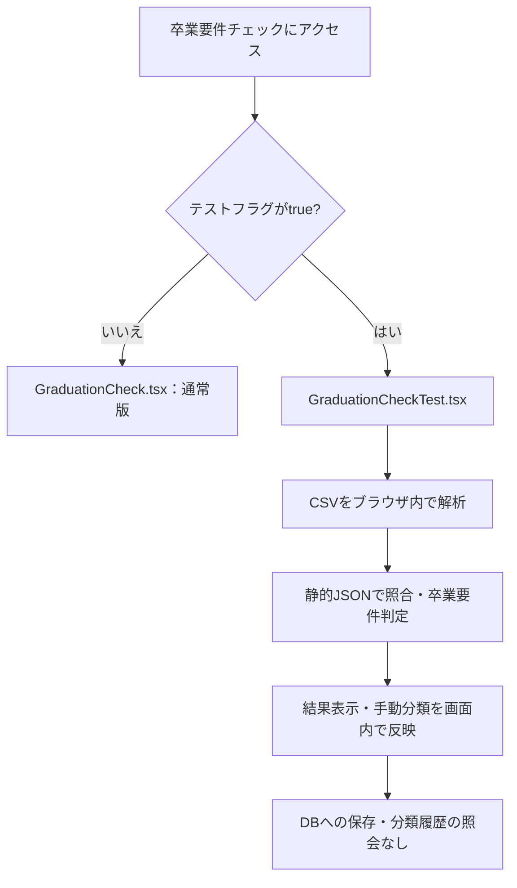

# 卒業要件チェッカーのテストモード

PowerShellで次のように起動します。

```powershell
$env:VITE_GRADUATION_CHECK_TEST = "true"
npm.cmd run dev
```

通常と同じ `/<universitySlug>/graduation-checker` にアクセスすると、
`GraduationCheckTest.tsx` を表示します。未設定、`false` など、`true` 以外は通常版です。
環境変数を変更したら開発サーバーを再起動してください。
ビルド時にもこのフラグが反映されます。

通常版に戻す場合：

```powershell
Remove-Item Env:VITE_GRADUATION_CHECK_TEST
npm.cmd run dev
```



| 機能 | テスト版 |
| --- | --- |
| CSV解析・卒業要件判定 | 有効 |
| 静的な年度別授業JSONの取得 | 有効（DB通信ではない） |
| 時間割の復元・保存・公開 | 無効 |
| 未分類科目の手動分類・再集計 | 画面内のみ |
| DBの分類履歴取得・分類結果保存 | 無効 |
| 任意の統計協力チェック | ONでも保存・公開しない |

対象はチェッカーとその結果画面のDB処理です。
アプリ共通の認証・大学情報・利用権限などの通信は継続するため、
アプリ全体をオフライン起動する機能ではありません。
判定結果は再読み込みで失われます。
